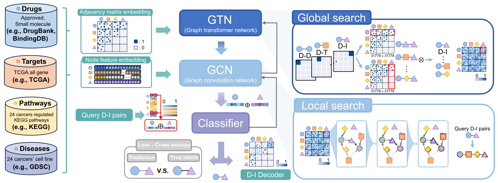

# GTCN

**Graph Transformer-Convolutional Networks for Predicting Drug–Cancer Associations by Encoding Drug–Target–Pathway–Disease Profiles**

**Authors:** Cheng-Yu Tung, Zi-You Bao, Guan-Wei Liao, and Jinn-Moon Yang.

**Original code:** [zhengyutong99/GTCN](https://github.com/zhengyutong99/GTCN)

**Code and datasets:** [bioxgem/GTCN](https://github.com/bioxgem/GTCN)

GTCN integrates drug, target, pathway, and cancer cell-line information in a heterogeneous graph to predict drug–cancer associations.



## Datasets

| Dataset | Description | Location |
| --- | --- | --- |
| GTCN | Cell line-based drug–cancer association dataset | [data/GTCN_dataset](data/GTCN_dataset/) |
| REDDA | Published drug–disease benchmark (Kdataset and Bdataset) | [data/REDDA_dataset](data/REDDA_dataset/) |

**GTCN nodes:** 2,614 drugs, 20,501 targets, 8,208 pathways, and 455 cancer cell-line identifiers.

| Relation | Number |
| --- | ---: |
| Drug–Drug | 1,222,904 |
| Drug–Target | 21,970 |
| Drug–Pathway | 7,589,721 |
| Target–Target | 196,105 |
| Target–Pathway | 18,909,648 |
| Drug–Cell line | 35,635 |

The GTCN dataset includes node lists, feature and interaction ZIP archives, drug-response measurements, and preprocessing notebooks. Archives are distributed in compressed form.

## Data sources

| Database | Use in GTCN | Source |
| --- | --- | --- |
| DrugBank 5.1.11 | Drug identities and interactions | [DrugBank](https://go.drugbank.com/releases/5-1-11) |
| BindingDB | Drug–target bioactivity | [BindingDB](https://www.bindingdb.org/) |
| TCGA | Cancer-related targets and co-expression | [GDC](https://portal.gdc.cancer.gov/) |
| KEGG | Biological pathways | [KEGG](https://www.kegg.jp/kegg/pathway.html) |
| GDSC | Drug sensitivity and cell-line associations | [GDSC](https://www.cancerrxgene.org/) |
| STRING 12.0 | Protein interactions | [STRING](https://version-12-0.string-db.org/cgi/download) |

The processed GTCN files are available in [data/GTCN_dataset](data/GTCN_dataset/). REDDA originates from the [REDDA repository](https://github.com/gu-yaowen/REDDA). Upstream databases may have separate reuse terms.

## Installation

Python 3.11.8 is specified for the original environment.

```bash
conda create -n GTCN python=3.11.8
conda activate GTCN
pip install -r requirements.txt
```

## Training

After preparing the required model inputs and configuring the input directory:

```bash
python main.py --model GTN --dataset Cellline-based_dataset --gpu_id 0 --folds 10 --epoch 5000 --lr 0.001 --node_dim 64 --save_dir ./results/
```

Set `--base_dir` for the prepared dataset (default: `/dataset`). The provided CSV and ZIP archives require preprocessing before running this command; see the included `Edge_preprocess.ipynb` and `Label_preprocess.ipynb`. GPU and dependency compatibility depend on the host environment.

With default settings, drug and cell-line representations are each **64-dimensional** and concatenated into a **128-dimensional pair representation**. Additional settings are documented in `args.py`.

## Evaluation notes

The implementation uses 10-fold pair-level stratified cross-validation (seed 777 for model initialization; split seed 42) and masks held-out drug–cell-line edges in two relation matrices. Checkpoint selection monitors test loss, so these results should **not** be interpreted as an untouched independent-test evaluation. REDDA comparisons follow the reported study protocol and are not reproduced by the command above alone.

## Citation and license

**GTCN study:** Tung, C.-Y., Bao, Z.-Y., Liao, G.-W., and Yang, J.-M. *Graph Transformer-Convolutional Networks for Predicting Drug–Cancer Associations by Encoding Drug–Target–Pathway–Disease Profiles*.

**Preprint:** Tung, C.-Y., and Yang, J.-M. *Encoding Drug-Target-Pathway-Disease Profiles for Drug-Cancer Association Prediction using Graph Transformer-Convolution Networks*. bioRxiv (2025). [doi:10.1101/2025.03.05.641572](https://doi.org/10.1101/2025.03.05.641572).

**REDDA:** Gu, Y., et al. *Computers in Biology and Medicine* **150**, 106127 (2022). [doi:10.1016/j.compbiomed.2022.106127](https://doi.org/10.1016/j.compbiomed.2022.106127).

Software is provided under the [MIT License](LICENSE). Third-party data remain subject to their respective terms.
